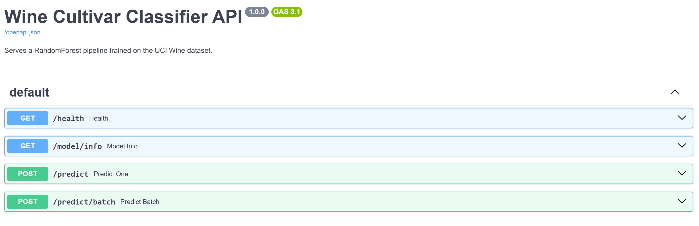
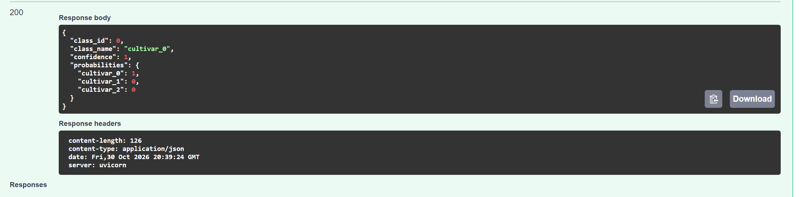
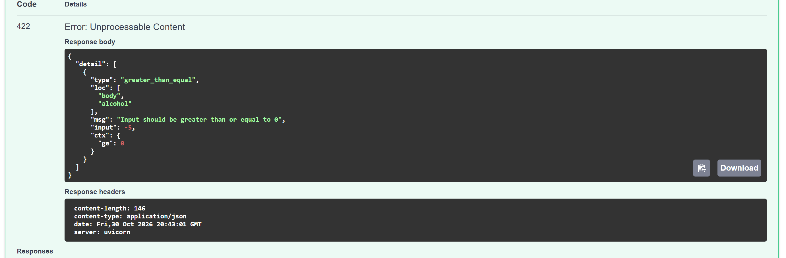

# Wine Cultivar Classifier API (FastAPI Lab 1, modified)

A FastAPI service that serves a scikit-learn model trained on the UCI Wine dataset. The project is containerized with Docker and tested automatically with GitHub Actions on every push.

Based on [FastAPI Lab 1](https://github.com/raminmohammadi/MLOps) from the Northeastern MLOps course.

## What changed from the original lab

| Area | Original lab | This version |
|---|---|---|
| Dataset | Iris (4 features) | Wine (13 chemical features, 3 cultivars) |
| Model | DecisionTreeClassifier | StandardScaler + RandomForestClassifier pipeline |
| Evaluation | None | Accuracy and macro F1 on a stratified test split, saved to `model/metrics.json` |
| Quality gate | None | Training exits with an error if accuracy drops below 0.90, which fails CI and the Docker build |
| Model loading | Loaded from disk on every request | Loaded once at startup using a FastAPI lifespan handler |
| Paths | Relative `../model` path, only works when run from `src/` | Absolute paths through `src/config.py`, works from any directory |
| Response | Class id only | Class id, class name, confidence, and per-class probabilities |
| Endpoints | `/`, `/predict` | `/health`, `/model/info`, `/predict`, `/predict/batch` |
| Validation | Type checks only | Non-negative constraints, a batch size limit of 1 to 100, and 503 when no model is loaded |
| Tests | None | pytest suite covering the model and every endpoint |
| Deployment | Local uvicorn | Docker image with a non-root user and a health check |
| CI/CD | None | GitHub Actions workflow that trains, tests, builds the image, and smoke-tests the running container |

## Project structure

```
wine-api/
├── .github/workflows/ci.yml
├── model/                  # generated by training, not committed
├── src/
│   ├── config.py           # paths, constants, feature order
│   ├── data.py             # dataset loading and stratified split
│   ├── train.py            # training, evaluation, quality gate
│   ├── predict.py          # model loading and inference
│   ├── schemas.py          # Pydantic request and response models
│   └── main.py             # FastAPI app
├── tests/
│   ├── conftest.py
│   ├── test_api.py
│   └── test_model.py
├── Dockerfile
├── pytest.ini
└── requirements.txt
```

## Run locally

All commands are run from the project root.

```bash
python -m venv venv
source venv/bin/activate        # Windows: venv\Scripts\activate
pip install -r requirements.txt

python -m src.train
uvicorn src.main:app --reload
```

Open http://localhost:8000/docs for the interactive API documentation.

## Run with Docker

```bash
docker build -t wine-api .
docker run -p 8000:8000 wine-api
```

## Endpoints

| Method | Path | Description |
|---|---|---|
| GET | `/health` | Service status and whether the model is loaded |
| GET | `/model/info` | Model type, training time, features, classes, test metrics |
| POST | `/predict` | Predict a single sample |
| POST | `/predict/batch` | Predict 1 to 100 samples in one request |

Example request:

```bash
curl -X POST http://localhost:8000/predict \
  -H "Content-Type: application/json" \
  -d '{"alcohol":14.23,"malic_acid":1.71,"ash":2.43,"alcalinity_of_ash":15.6,"magnesium":127,"total_phenols":2.8,"flavanoids":3.06,"nonflavanoid_phenols":0.28,"proanthocyanins":2.29,"color_intensity":5.64,"hue":1.04,"od280_od315":3.92,"proline":1065}'
```

Example response:

```json
{
  "class_id": 0,
  "class_name": "cultivar_0",
  "confidence": 1.0,
  "probabilities": {"cultivar_0": 1.0, "cultivar_1": 0.0, "cultivar_2": 0.0}
}
```

## Tests

```bash
pytest -v
```

## CI pipeline

On every push or pull request to `main`, the workflow:

1. Installs dependencies and trains the model, failing if accuracy is below 0.90
2. Runs the pytest suite
3. Uploads `metrics.json` as a build artifact
4. Builds the Docker image, starts the container, waits for `/health`, and sends a test prediction

## Design notes

- Endpoints that run inference use `def` instead of `async def`. Model inference is CPU-bound, so FastAPI runs these handlers in a threadpool. An `async def` handler would block the event loop during prediction.
- The scaler and classifier are saved together as one pipeline so inputs are always transformed the same way as during training.
- The model is trained inside the Docker build, so every image ships with a model that has passed the quality gate.

## Screenshots

### API docs


### Successful prediction


### Validation error

